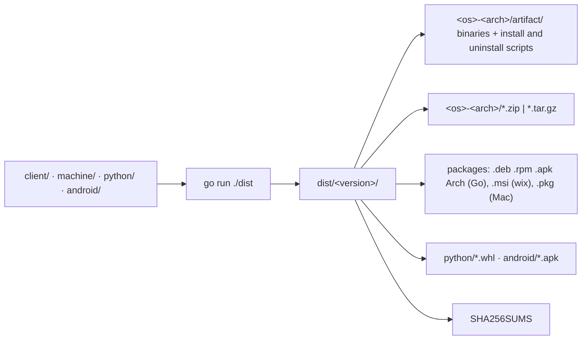

# Build and deploy: builds and installers

Part of [Build and deploy (`tools/`, `devhelpers/`, `server/Dockerfile`, `server/docker/`, `ui/Dockerfile`, `site/`, `sandbox/`, `deploy/`)](README.md). `tools/dist`, and how the server hands out builds and installers.

## `tools/dist` (its own Go module, no dependencies)

- 16 targets (Windows, Linux incl. arm/riscv64/s390x/loong64, Android ARM64 for Termux, macOS, FreeBSD), built with `-trimpath` and `-X main.version`. Most use `CGO_ENABLED=0`. Android ARM64 uses `CGO_ENABLED=1` with the NDK API 24 compiler and `-buildmode=pie`, producing `ET_DYN` with `/system/bin/linker64` and libc DNS (`getaddrinfo`). `android_compiler.go` finds `CC`, the compiler on `PATH`, `ANDROID_NDK_HOME`, or SDK `ndk/*` folders; a missing compiler fails the build rather than shipping broken DNS. The ELF regression test checks both the loader and the libc resolver import when an NDK is available. The Linux ARM64 build is for Linux. Components: `agent` (agent and agent-proxy) and `agent-machine`.
- Archives and Linux packages are written in Go (execute bits survive NTFS). A missing external tool (wix, pkgbuild, a JDK or Android SDK) skips its format with a note.
- The wheel is written in Go from `python/pyproject.toml`, with `_version.py` stamped in. It is skipped when the version isn't PEP 440.
- Flags: `-version`, `-root`, `-out`, `-only`, `-packages`, `-android`, `-python`, `-print-version` (used by the build scripts).
- The APK is a release build only when `android/keystore.properties` exists, else a debug build (which carries the Android Auto service); see `.context/android.md`.

## Handing out and installing

Both one-line and local installer pairs run the tray's `--setup` before launching it detached. On Debian/Ubuntu this installs missing GI/GTK/AppIndicator packages with apt/sudo and enables GNOME's indicator extension, then verifies its D-Bus watcher. The Unix installers prefer `/usr/bin/python3` for desktop tray installs so GI matches. A failure prints the dependency or session problem and leaves the rest of the installation usable; it does not claim that the tray started. Autostart stays enabled for the next sign-in after dependencies are fixed. `--no-tray` bypasses setup. Ubuntu's tray uses system bindings through the Python tray loader, including from the installer's venv; see `docs/local.md`.

- `downloads.py` serves `dist/<server version>/` (or the newest with the same `X.Y.Z`), only files in `SHA256SUMS`, publicly, at `/downloads/...`. `/downloads/index.json` is what `agent update` and `agent-machine update` read.
- `agent-server downloads fetch` (`fetch_builds.py`, dispatched in `app.main`) fills `dist/<X.Y.Z>/` from a GitHub Release for a server with no build of its own (the published image, an install without Go): it reads the release's flat `SHA256SUMS`, downloads only the archives and the wheel, refuses a mismatch before replacing anything, and writes tools/dist's layout (`<platform>/<archive>`, `<platform>/artifact/<program>` from each archive's own `<platform>/` folder, `python/<wheel>`, a new `SHA256SUMS`). A server on `X.Y.Z+<commit>` then serves it as the newest of its `X.Y.Z`. It's an administrator's command with plain `urllib` (the environment's proxy applies), not the server's `runtime.client`: the running server never downloads builds. `deploy/compose/server` mounts `dist/` writable for it (`docker compose exec --user 0 ...`). The image itself stays without builds: every platform's are about 440 MB.
- **One-liners** `/install.sh` and `/install.ps1` (`installer.py`, templates in `server/agent_server/install/`): the server fills in its address (checked against `SAFE_URL`) and the archive table, plus the wheel as `python python <sha> <url>` in both scripts. They download, check hashes, and run the archive's own installer with `AI_PROXY_ONE_LINER=1`, then sign in from `/dev/tty`. With `--python`/`-Python`, or when there's no archive for the platform (an unknown OS or processor no longer fails), they install the wheel instead into their own venv (`~/.local/share/agent-py`, `/usr/local/lib/agent-py` as root, `%LOCALAPPDATA%\agent-py`) and link `agent`, `agent-proxy`, `agent-machine` into the prefix (Windows: copies of pip's launchers, which name the venv's python.exe by full path). The uninstallers remove those links but leave the venv. In PowerShell, variable names ignore case: a `$python` variable is the `-Python` switch, so the interpreter is `$interpreter` (the sh scripts use `use_python`/`interpreter` alike).
- **Archive installers** (`tools/dist/install/`): `install.sh` (to `/usr/local/bin` or `~/.local/bin`; `--service` sets up systemd, launchd or rc.d; `--uninstall`) and `install.ps1` (to `%LOCALAPPDATA%\Programs\agent-proxy`, user PATH, `-Service` as an at-logon task).
- **Uninstallers** (`server/agent_server/install/uninstall.sh`, `uninstall.ps1`): one file each, not templates. The server serves them as they are (`/uninstall.sh`, `/uninstall.ps1`, `installer.uninstaller`, no build needed) and `tools/dist` copies them into every archive (`writeUninstaller`, LF for `.sh`), where `install.sh --uninstall` and `install.ps1 -Uninstall` hand over to them. They undo `--service`, stop agent-machine and this install's agent-proxy, remove the `servers service` sudoers rule as root, and with `--purge` log out (one server per `logout`, looped) and delete the default settings folders. On Unix, with no explicit prefix and no programs in the default prefix, a direct pip installation of all three Python commands is stopped, signed out when purging, and removed with `python -m pip uninstall`; an explicit prefix never touches pip. The service names and paths in them must match `install.sh`/`install.ps1`. `AI_PROXY_SCHEDULED_TASK` renames the Windows task for tests (the dev computer has a real one); the archive `install.ps1` and the uninstaller both honour it.
- Test installers and services as a throwaway user in another WSL distro, never as the Ubuntu user (it runs a real agent-machine, and `install.sh --service` would stop it and join the test service to the real fleet). WSL has Ubuntu, `FedoraLinux-44` and `archlinux`; for Alpine, `wsl --import` its minirootfs. `wsl -d <distro> -u root` is root without a password: install the built packages with each distro's tool (`dpkg -i`, `dnf install`, `apk add --allow-untrusted`, `pacman -U`) and remove them again. For services, `useradd -m aptest`, then `SUDO_USER=aptest ./install.sh --service` as root. Use `wsl --exec sh -c '...'`: plain `wsl -- ...` runs the line through another shell first, which expands `$?` too early. The same goes for the one-liners (`/install.sh`, `/install.ps1`).
