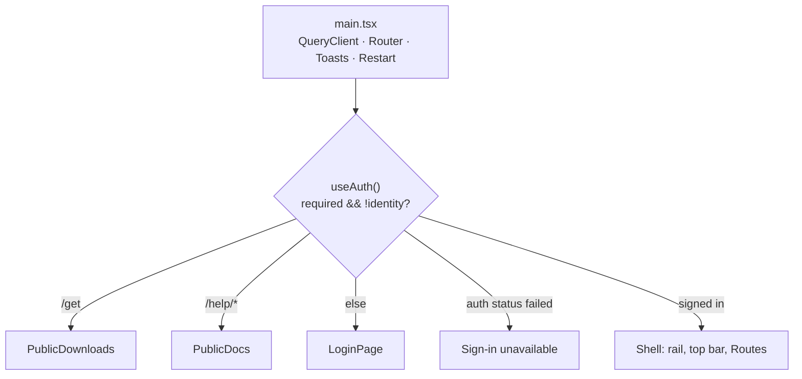

# Console: shell and routing

Part of [Console (`ui/`)](README.md). The app shell, navigation and routes.

## Shell and routing

- `main.tsx`: queries retry once, never on a 401; any 401 invalidates `["auth"]`, which drops back to sign-in.
- `App.tsx`: the mandatory auth gate reads `window.location.pathname`, not the router. When `/api/auth/status` itself fails (the issuer or API is down) before any identity was confirmed, it shows "Sign-in unavailable" rather than `LoginPage`; `/get` and `/help` still render. Once signed in, a failed recheck keeps the last identity and the Shell mounted (unmounting it would abort Ask a model's stream and close terminals); only a status that answers signed out shows `LoginPage`. `/pair` is a Shell route and requires sign-in.
- Authentication is mandatory and fail-closed. Login redirects to the API's PKCE flow; only the issuer collects passwords. `api.ts` renews access cookies ahead of expiry (`scheduleRenewal`, from `expires_in` on `/api/auth/status` and `/api/auth/refresh`; again at once when a throttled background tab becomes visible), serializes refreshes per tab and through Web Locks (a localStorage lease on plain HTTP), and skips one another tab already made (`refreshSignIn(since)`); every renewal calls `onRenewed` listeners with the new access token (another tab's is read back from `/api/auth/status`). The terminal viewer sends it over its socket (`{"type":"token"}`), and `useLive`/`followReply` open the next stream on the new cookie and switch to it at its snapshot, so neither is cut when the token they opened with expires; auth status polls every 30 seconds. The header polls `/api/status?recent=0` and `/api/terminals?open=1`; only the Overview asks for the recent request records (`useStatus({ recent: true })`). Terminal reconnects check status before dialing. Legacy `/pair` links redirect to terminals; expired permissions show sign-in, never a key form.
- `Shell`: the rail is the Overview (`/overview`, `OverviewPage`), then `visibleSections(siteAdmin, admin)` from `navigation.ts`, then the foot: `HELP_LINKS` (Downloads, Documentation), `AccountMenu`, the connection, the theme switch and the version. It shows counts (in-flight requests, connected terminals, connected machines; agents waiting for their user replace the terminals count, and `AttentionAlerts` shows them as slim bars above every page). `RailLink` is a plain `Link` whose `active` class comes from `linkActive` (so `/machines#add` never lights up with All machines, and `/machines/<id>` keeps All machines lit). **Go to…** (`.rail-search`, and Ctrl/⌘ K anywhere through `useCommandShortcut`) opens `components/CommandMenu.tsx`: a `<dialog>` searching `visiblePages()` (each page's `hint`) and the machines from the shared `["machines"]` query, arrow keys and Enter to open. Below 900 px it becomes a top bar (menu button first, at the left, then the wordmark and a search button) with a slide-in menu. Opening the menu pushes a history entry, so Back (Android's included) closes it. Each section heading is a button that folds its group (`useFoldedSections`, the section `id`s in localStorage `ai-proxy-nav-folded`); a folded group still lists the active page. `rail-toggle` collapses the desktop rail to 64 px of icons (`useRailSlim`, localStorage `ai-proxy-rail-slim`, `.shell.rail-slim`, its rules inside `min-width: 901px` so the phone menu never loses its names); links then carry their label as `title`.
- Old addresses (`/models`, `/strata`, `/docker`, `/containers`, ...) redirect to `/machines`.

`navigation.ts` has two views of the same pages. `SECTIONS` is the rail, grouped by task: **Agents** (Start an agent, Live agent view, Running agents, Ask a model), **Models** (Providers, Subscriptions, Shared with you), **Machines** (All machines, Add a machine, Approve a device), **Activity** (Live, Traffic, Requests, Sessions), **Analytics** (Usage, Sessions by day, Model calls by day, Cost by day, People by day, Costs and prices), **Logs** (Access log and API log for site admins, Audit log for admins) and **Administration** (Organizations; Server settings and Server stats for site admins). Each page is defined once in `PAGES` (`to`, `label`, `icon`, `hint` for the command menu, `siteAdmin`/`admin`). `PARTS` is the three parts a request passes through (agents, the server, machines, with their numbers), which only the Overview's cards and the routing map use (`partsById`). `sectionFor()` drives `PartTag`, the breadcrumb above each `<h1>` ("Activity › Requests"); its `trail` prop adds what is deeper than the page (a machine's name, a request's session and number), so no page builds a breadcrumb of its own. The pages in detail: **Agents** (`/live-agents` Live agent view, `/agents` Start an agent, `/terminals` Running agents, `/providers` Providers: `pages/Providers.tsx`, `["providers"]` from `/api/providers`, cards grouped On machines / Hosted APIs / Subscriptions with your usage in a chosen window, `LimitMeter` per limit and `BlockedNote`, all as the server reports them, `/subscriptions` Subscriptions: `pages/Subscriptions.tsx`, provider accounts with `["provider-accounts"]`/`["provider-account", id]`, usage windows and the estimated remaining balance as the server reports them (never computed in the browser), assignments, token store/revoke (the field is cleared, nothing kept), settings, history; `/ask` Ask a model: `pages/Ask.tsx`, a session of client `console-chat` and `askModel` in `api.ts` streaming `/session/<id>/v1/chat/completions` with the browser's sign-in, as an agent would, plus `X-AI-Proxy-Finish: 1` so the server reads the reply to the end; when the stream drops (not an `ApiError`, not Stop), `followReply` picks the rest up from `/api/live` by the reply's `X-Request-ID`; Stop also calls `api.stopReplies`), **Machines** (`/machines`, active on individual machine pages too; `/approve-device` Approve a device), **Server** (`/live`, `/traffic`, `/requests`, `/sessions`, `/server-stats`, `/access-log` (`pages/AccessLog.tsx`, site admins: Overview `["access-log-stats"]`, Since this start `["access-log", failed, q]`, Saved history `["access-log-history", failed, fleet, q]`), `/api-log` (`pages/ApiLog.tsx`, site admins: the request log, `["request-log-summary"]` with a debug-mode toggle, `["request-log", filters]` polled while Follow is on, paged by `before` time, a row's payload `["request-log-entry", id]` read when opened), `/audit` (`pages/AuditLog.tsx`, admins only: rail items marked `admin`; `["audit", filters]` is an infinite query paged by the server's `next_before` cursor, opaque to the browser; downloads and Verify chain for admins; Sign checkpoint now for site admins only), `/settings`, `/organization`, `/get`).

`MachinesPage` lists machines in responsive rows (name, architecture, last contact, function states), with a case-insensitive search over name, id, hostname, address and owner. `MachineRow` uses reported flags for agents, terminals, server management, containers, updates and tunnel; model servers use `machineProviders`, MCP uses reported servers. These describe configuration/presence, not `machine.you` permissions or connection readiness. Searching only filters the rows; fleet totals and the add/removed-machine controls stay unchanged. Adding a machine (`#add`) is `JoinSteps`: a system switch (sh, PowerShell, Python or Docker container) and an install switch (agent-machine, or agent-machine and agent; hidden for a container), both kept in `localStorage`, give one command from `installLine()` in `Downloads.tsx` (shared with `OneLineInstall`), a start-by-itself checkbox (`--service`) and a list of what the command does. `PythonSteps` gives pip with the build's wheel (from `/downloads/index.json`), then `agent-machine login` and `start`. `SandboxSteps` (a `sandbox/Dockerfile` container, the Docker container system) has its own engine and shell switches and an optional name field (`dockerName()` slugs it; not remembered, since a leftover name would point the next sandbox at another's volumes). The name adds to `SANDBOX_BASE` and names the container, its hostname (the sandbox names the machine after it; Docker's default is the container id) and both volumes (`-home`, `-workspace`), so one computer can run several sandboxes; it flows into `RemoveSteps` as its `container` prop so `exec`/`rm`/`volume rm` name the same sandbox. `RemoveSteps` (under each system's steps) is the way back out for the same choices: `uninstallLine()` in `Downloads.tsx` (shared with its Uninstall panel) for sh/PowerShell, pip and the settings folders for Python, `rm`/`volume rm`/`image rm` for the container, with a purge checkbox; it ends by pointing to the machine page's **Remove from this server**.
