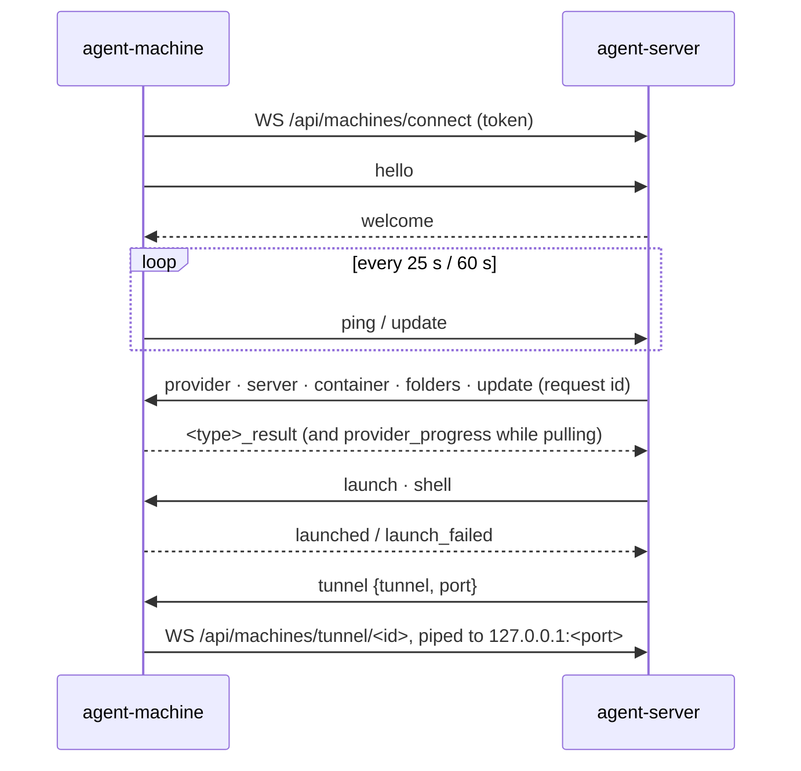

# Machine: fleet protocol

Part of [Machine (`machine/`)](README.md). The fleet protocol as the machine sees it: the connection, requests and replies.

## Fleet protocol, from the machine

- **Hello/update** (`describe`): id, name, hostname, os, arch, version, protocol, address, `agents` (the server's agents found on PATH), `providers` (`{type, port, version, models, api_key?, flavor?}`, detected by probing 11434, 12434, 18500, llama.cpp's port (9931, `AI_PROXY_LLAMACPP_PORT`) and Strata profiles; then type `api`, other OpenAI-compatible servers, on 1234 (`flavor: lmstudio`), 8000 (`vllm`), 30000 (`sglang`) and the ports in `AI_PROXY_API_PORTS` (comma separated, `openai`), each only when its `GET /v1/models` answers 200 with `{"data": [...]}` whose items all have an `id` (8000 is used by much else), and only on a port no other kind reported: `{"type": "api", "port": 1234, "models": 2, "flavor": "lmstudio"}`), `launches`, `roots`, `commands`, `updates`, `files`, `tunnel: 1`, `launcher`, `containers {enabled, cli, engines, ...}`, `servers {enabled, ollama, strata, llamacpp}` (`llamacpp`: found, running, managed, port, version, source, variant, release, platform, install progress), `mcp {port, key, servers}`, `accounts {clis, at, error}` (`presence/accounts.go`: `agent accounts detect --json` run every 5 minutes in the background, `{"clis": []}` until the first look, an update sent at once when a look changes it; metadata only). A launch's `account` becomes `--account <id>`. Strata keys travel only as `providers[].api_key`, for loopback instances.
- **Requests**, each handled in its own goroutine, with writes serialised:

| Type | Gate on the machine | Does |
| --- | --- | --- |
| `provider` | changes (pull, delete, load, unload) need `servers`, and a port that's one of its model servers (`Manager.Serves`: reported in the last hello, or a container's, as a tunnel may reach) or that answers as that kind (`answersAs`, `kindPaths`), so nothing else on loopback gets a change | status, models, log, metrics (the load sample, below), `machine_log` (the end of `settings.LogPath()`, `tailFile`, with no switch: nothing secret is written there), catalogue search; kind `api` (`api.go`) answers only `status` (`{"online", "version": "", "models": [{id, owned_by, context_length?}]}` from `/v1/models`, `context_length` from `context_length`, `max_model_len` or `loaded_context_length`), every other op is refused: its models are managed in that server itself |
| `server` | `servers` | Ollama settings and start/stop/restart; llama.cpp settings, start/stop/restart, `install_options`, `install` (a job: answers at once) and `uninstall` (GitHub builds only); Strata start/stop, remove/prune (profiles whose run config is gone, deleted from Strata's profiles folder) and cleanup (`strata runtime cleanup`) |
| `container` | `containers` | status, start/restart/switch (jobs), stop, remove, logs |
| `folders` | `launches` or `commands`, inside the roots | folder names only, at most 500 |
| `files` | `files`, inside the roots (hidden names included) | op `list`: folders and files (`kind`, `size`, `modified`), at most 1000; op `read`: text at most `FileReadLimit` (1 MiB, `truncated`), or a signature-detected PNG/JPEG/GIF/WebP/BMP/ICO at most `ImageReadLimit` (10 MiB), with `binary: true` and `image: {media_type, data}` (base64). Oversized images have `truncated: true` and no bytes; other binary files send no bytes. SVG stays text. The image field is additive; older machines omit it |
| `launch` / `shell` | `launches` / `commands`, inside the roots; a launch's `agent` is a name, never empty or an option (it's the `agent` command's first argument, and `--shell` there would open a shell past `commands`) | runs `agent ... --headless --launch-id` and reads its one `{"session_id"}` line |
| `update` | `updates` | runs `agent-machine update` detached |
| `tunnel` | port reported, a container's port, or the bridge | pipes bytes to `127.0.0.1:<port>`; closes 4502 if nothing answers |

- **The load sample** (`providers.Metrics`, op `metrics`; cached for a second, never stored): `hostname`, `platform`, `timestamp`, `cpu`, `memory`, `gpus` (nvidia-smi), then `uptime_seconds`, `load_average` (null on Windows), `swap`, `network` (running totals over the interfaces that aren't loopback: `/proc/net/dev` on Linux, `GetIfTable2` on Windows counting only interfaces with a connector, `netstat -ibn` elsewhere), `disks` (the filesystems holding `Home()`, `Data()` and the roots, each once, with `holds`; roots read from `machine.json` directly, since `LoadMachine` writes a missing file), `process` (agent-machine's `pid`, `rss`, goroutines as `threads`, `started_at`) and `agent` (`providers.Activity`, atomic counters presence reports into: `connected_since`, `connects`, `requests`, `tunnels_open`, `tunnels_total`, `tunnel_bytes_in`, `tunnel_bytes_out`). Every key is always there; a part the system can't report is null (`disks` is `[]`) and never fails the sample. The readers are split by system (`metrics_linux.go`, `metrics_windows.go`, `metrics_other.go`, `metrics_unix.go`), the parsers in `metrics_parse.go` so they're tested everywhere. The console works out rates from the totals.
- An update also goes out at once after a `server` request that changed something and after a launch.
- Reconnects back off 2, 5, 10, 30 s with jitter (half to one and a half times; reset after a connection that lasted a minute). After the welcome the connection has a 70 s read deadline (`readTimeout`) that the server's pings, the machine's own WebSocket pings (every 25 s) and every message move on, so a half-open connection is noticed; a failed write closes it, so `Run` reconnects at once. Tunnels have the same read deadline and a 30 s write deadline. A 426 or close 4426 means a protocol mismatch; a close 4410 means the access token expired, so it's rejected and the machine reconnects at once (without the back-off, the first time) with a refreshed one. To avoid that, a goroutine of its own checks `AccessToken` every `renewEvery` (10 s) and sends each newer token as `{"type": "token"}` over the open connection, and the current one every `resendEvery` (60 s); tunnels do the same.

Authentication lives in the common `agent-proxy/credentials.json` (or `AI_PROXY_CREDENTIALS`), with the common refresh lock. `AI_PROXY_MACHINE_HOME` does not move auth. The shared settings helper and migration rules are documented in `.context/client.md`. Login reuse still applies `--enable`. A changed shared selection closes the old fleet connection at the next renewal and reconnects to the selected server; commands arriving from the old server are refused before dispatch. Status callbacks update the stored server and clear an old server version on a switch, so updates use the selected server; logout closes it without treating an issuer outage as logout.
