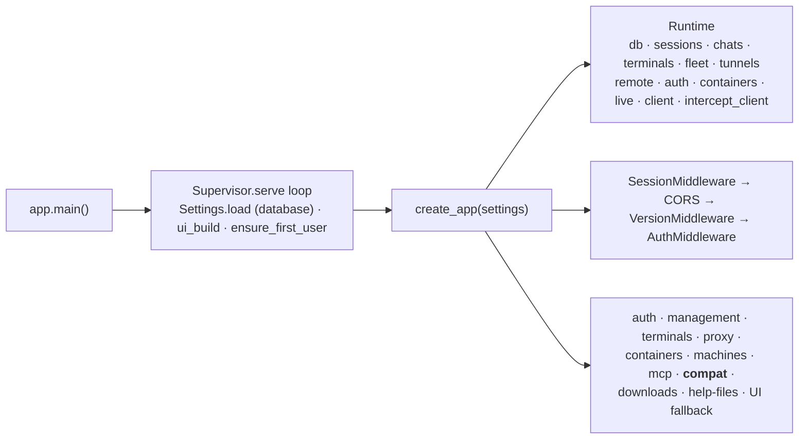

# Server (`server/agent_server/`)

`agent-server`: Python, FastAPI and uvicorn. The hub. It owns the API, accounts, all configuration, agent definitions and template rendering, backend choice, recording, HTTPS interception of account agents, and the fleet registry, and keeps all of them in one database (`db/`: PostgreSQL in production, SQLite by default; there are no configuration files). It optionally serves the console's build; `AI_PROXY_SERVE_UI=0` disables UI routes and automatic UI builds for separate hosting. The same package holds `agent-auth` (`issuer.py`), the OIDC issuer the API depends on but runs as its own process, and `agent-benchmark` (`benchmark.py`).

## Files in this folder

| File | Covers |
| --- | --- |
| [README.md](README.md) | This page: the design, boundaries and rules |
| [modules.md](modules.md) | The core modules: storage, configuration, recording, routing, the fleet, security and distribution. Feature modules are in [features.md](features.md). |
| [features.md](features.md) | Modules for features built on the core: provider accounts, usage limits, logs, retention, peering and chats. Session reviews and cost estimates are in [reviews-and-costs.md](reviews-and-costs.md). |
| [reviews-and-costs.md](reviews-and-costs.md) | The session review (checks, scores, exposure scanning, the AI review) and the price table behind cost estimates. |
| [flows.md](flows.md) | How a request moves through the server. |
| [state-and-config.md](state-and-config.md) | What the server keeps, where, and how settings and environment variables are read. |
| [rules.md](rules.md) | The rules every server change keeps, and the security model behind them. |
| [processes.md](processes.md) | Running the API as more than one process: what each kind of state does to stay correct. |
| [extending-and-tests.md](extending-and-tests.md) | Checklists for a new route, backend type, agent, setting or table; how the tests are built; known gaps. |

## Design in one paragraph

Every agent request arrives at one ASGI app. `routes/compat.py` finds the session, picks its backend, then either translates the request (Ollama) or forwards it (Strata, Docker, llama.cpp, Anthropic). Each request is tracked by `Runtime` and recorded in the database (`requests`, `traces`), written behind by `db.Writer` so the event loop never waits on it. Machines hold a WebSocket open to the server (`/api/machines/connect`); the server asks them to do everything about a model server (`Fleet.ask`), and reaches the model servers on machines behind NAT through tunnels that the machine dials back. Account agents' HTTPS arrives as WebSocket tunnels and is decrypted with the server's own CA. Shared state lives in one `Runtime`, and there are no globals apart from two in `strata.py`: `managed_keys` (filled by `KeyStore`) and `fleet` (set by `Runtime`, for the keys machines report).

## Must never

Agent session resolution checks control permission and ended state. Unscoped forwarded GETs do not create recordings; protocol validation precedes implicit session creation. New implicit sessions receive seven-day session retention when otherwise unlimited, respecting the policy minimum. Non-site-admin status responses use the request's public origin/address and omit backend URLs; model discovery hides machine runtime details from callers without machine view permission. The built-in SPA sends framing, object, base-URL, sniffing and referrer headers. Refused intercept audit events include the trusted HTTP connection address or direct socket peer.

- Call a model server for anything but agents' traffic. Listing, pulling, status, logs, metrics, Ollama settings and start/stop are fleet requests to the machine. Native `/api/*` passthrough only allows `compat.NATIVE_AGENT_PATHS`, and `_forward` refuses a path with a `.` or `..` segment (the HTTP client would resolve `/v1/../api/pull` into the model server's own API).
- Send one of the server's environment secrets to an address someone else chose. Only a site admin sets a provider's `key_env` (`routes/api_providers.py` keeps or drops it for an organization's admin), and an audit export's `token_env` can't name the server's own settings (`audit.py`).
- Run `docker`, or add a local backend (`MACHINE_TYPES`: ollama, llamacpp, strata, docker) by URL. `Settings.update_network_config` refuses new or moved ones; only `anthropic` is added there by URL, and hosted `api` backends only through `/api/orgs/{org}/providers` or `/api/config/providers` (`api_providers.validate`).
- Reach a hosted `api` backend with anything but `runtime.api_clients` (`api_providers.ProviderTransport`: resolves, refuses non-public addresses unless `AI_PROXY_API_PRIVATE_HOSTS` lists them, pins the checked address, follows no redirect), put its key anywhere but `provider_credentials` (`ApiKeys`, AAD bound to the origin) or an `AI_PROXY_API_KEY_*` variable, or let `key_env` name any other variable. Keys never go in `Backend.options`, `config export`, records, traces, logs or responses.
- Retry a request on a `fallback` provider after anything but a connection failure (`httpx.ConnectError`/`ConnectTimeout`), or move a session's own backend; pick a hosted `api` backend in `backend_for` unless it's named or the default.
- Import client, machine or Python-port code, or assume anything about them beyond the API.
- Keep cookies in the upstream client (`runtime.upstream_client`), replace an agent's own `Authorization` on hosted pass-through, or forward it to an MCP bridge.
- Send platform credentials upstream: `compat._upstream_headers` drops `X-AI-Proxy-Token`, cookies, Origin and the session/backend headers, and drops `Authorization` only when it was the platform's Bearer (no `X-AI-Proxy-Token`).
- Treat anything but the middleware's introspected identity as authentication: not loopback, a session id or the old access key. The one other authentication is a linked server's link-key signature on the peer routes (`/api/links/present`, `/api/links/connect`, `/api/links/relay/*`), checked by `Links.verify` first, which never yields an `Identity`.
- Let a `bridges.Guest` through an existing permission helper, or serve one anywhere but the peer routes; let a `link` backend be used by another tenant, or crossed onward (one hop: a provider received is never let out); send a provider's key, an MCP bridge key or a machine's credentials to a linked server.
- Write dialect-specific SQL outside `db/`, or edit an existing migration step. Queries are SQLAlchemy Core over `db.schema`, so they run on PostgreSQL and SQLite alike; a schema change is a new step appended to `db/migrate.py`.
- Keep a secret in the settings (`settings` table, what `config export` writes). Generated secrets go in the `secrets` table; passwords and the introspection secret come from the environment.

## Composition

Ollama installation is a fleet operation: `GET /api/machines/{id}/servers/ollama/install` asks for `install_options`, and `POST` with a chosen variant asks for `install`. Both require the `servers` grant; mutations also require same origin. `fleet._servers` retains Ollama `install_available` and the shared bounded `_install_job` progress fields. The server never runs package managers. Go and Python contract tests cover the operation through a real machine connection.

- **Router order is load-bearing.** `compat` has catch-alls (`/api/{path}`, `/v1/{path}`, `/anthropic/{path}`), so every console route registers before it, and the UI fallback comes last. Within a router, literal paths come before parameterised ones.
- **Middleware order** puts the version check before auth, so old programs get 426 (WebSocket close 4426) before a 401. `routes/auth.register` adds Starlette's `SessionMiddleware` (the signed `mesh_oidc_state` cookie for the browser sign-in) after those; `create_app` then adds `TerminalForward`, `AuditMiddleware`, `InternalGate` and `AccessLogMiddleware` outside it, so `AccessLogMiddleware` is the outermost.
- **Split console/API**: `Settings.console_origins` (`AI_PROXY_CONSOLE_ORIGINS`) is the exact origin allowlist for credentialed CORS and `remote.same_origin`, shared by auth mutations and route/WebSocket gates. Cookies stay host-only on the API; no parent-domain cookie or wildcard origin.
- **Restart** (`POST /api/server/restart` → `Runtime.request_restart`): waits up to 30 s for in-flight requests (`Runtime.active`; container jobs run on machines and aren't waited for), then `_restart_when_idle` closes live streams, terminals, fleet sockets, tunnels and intercept tunnels, and the Supervisor serves again with a fresh `Settings.load()`, which reopens the database and re-reads the stored settings. **A new long-lived connection must be closed there.** There's no Supervisor with `--reload` or in tests.
- **Storage lifecycle**: `Settings.load()` opens the database (`open_database`: migrate, a one-time legacy import into a new database, `seed`, `sync_builtin_agents`, then the stored settings with the environment on top). `Runtime` takes `settings.open_database()` and hands it to every store. The lifespan starts `Runtime.prune_daily` (retention, hourly) and, on shutdown, closes the database last (`runtime.db.close()` drains the write queue first). **A new store that buffers or queues writes must flush or close in the lifespan, before that.** `agent-server config|db` (`commands.py`) and `agent-server user|org|team` open the same database from the shell.
- `ensure_first_user` runs in `main()` (with `--reload` too) and every `Supervisor.serve` round, including loopback, never in `create_app`. It does nothing once accounts were ever written (meta `accounts_initialized`, `UserStore.initialized()`) or `AI_PROXY_USERNAME`/`AI_PROXY_PASSWORD` are set. Tests must authenticate explicitly; no anonymous local mode remains.
- `issuer.py` runs the separate `agent-auth` Authlib service (`create_auth_app`, never mounted into the API app): PKCE, device and service grants, hashed transactional token state (`State`: schema `mesh_auth` on PostgreSQL, else a SQLite file of its own), discovery/JWKS, introspection, revocation and userinfo. It reads but never mutates API accounts. API `Auth` introspects with a dedicated client (closed in the lifespan); browser `routes/auth.py` manages host-only access/refresh cookies. See `.context/auth/credentials.md`.
