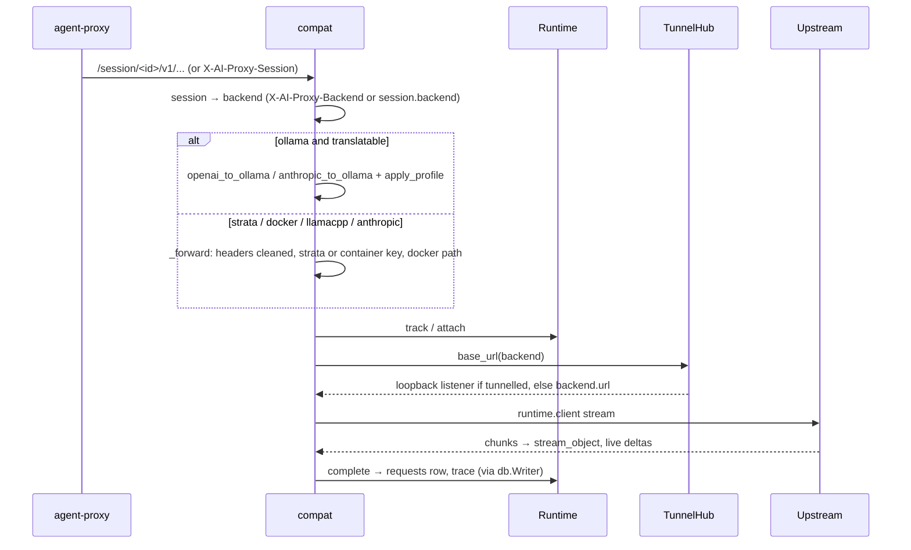

# Server: core flows

Part of [Server (`server/agent_server/`)](README.md). How a request moves through the server.

## Core flows

Server stats (`stats.ServerStats`, `GET /api/server/stats`) treat OS probes as optional, including process construction and CPU priming during route registration. Restricted `/proc` access never prevents startup or fails a sample: unreadable CPU, memory, swap, boot time and process fields are null, CPU count defaults to 0, network is null and disks are empty when unavailable. Each process field is probed separately. Prometheus omits unavailable host/process metrics while keeping the server's own counters. Folder size checks also tolerate denied access.

`local.py` still requires a verified process identity before signalling a recorded process. If the identity cannot be read just after spawning, it reaps that child through its own subprocess handle and reports a startup error instead of leaving an untracked process. When other processes cannot be enumerated, stop still attempts the verified parent. Raw `OSError` is handled alongside psutil's errors.

**Agent request** (`routes/compat.py`)

- Before compat runs, `AuthMiddleware` has already required an access token and, for a session path or `X-AI-Proxy-Session`, an open session the caller can control (404 otherwise).
- Docker Model Runner paths are remapped by `model_runner.upstream_path()`: `/v1/messages*` to `/anthropic/v1/messages*`, other `/v1/*` to `/engines/v1/*`, `/api/*` unchanged. Ollama's own `/v1` ignores `num_ctx`, which is why Ollama traffic is translated to `/api/chat` rather than passed through.
- `MESSAGES_BACKENDS` (anthropic, strata, docker, llamacpp, api) take Anthropic Messages as they are; Ollama gets them translated. Strata, llama.cpp and api refuse native `/api/*` (400).
- **api backends** (`_forward`, `_api_protocol`, `_upstream_for`, `_api_payload`, `_fallback`): the path's protocol (`api_providers.protocol_for`) must be one the backend speaks (400 before anything goes out; 404 for other `/v1/*`); the model alias is mapped; `_upstream_for` gives the client (`runtime.api_clients[verify_tls]` for hosted, `runtime.client` through `tunnels.base_url` for a machine's), URL (`target`), headers (key; 503 without one) and the per-backend timeout. A `ConnectError`/`ConnectTimeout` tries the backend's `fallback` list (`_fallback`: enabled api, usable by the caller, speaks the protocol, knows the model, not over the limit), recorded (`fallback_from`, `routing`), logged and audited (`backend.fallback`); the session keeps its backend. Records add `protocol`, `upstream_model`, `rate_limited`. `_observe` keeps `runtime.api_health`. `/v1/models` for api lists aliases then `discover`. `count_tokens` is estimated for an api backend without `anthropic`.
- llama.cpp backends: `_list_models` asks `/v1/models`; `management._backend_models` lists the router's models except `downloading`/`incomplete` ones, with `context_length` None (llama.cpp doesn't say the running context). `routes/machines.py` has `GET`/`PUT /servers/llamacpp` (`server_settings`/`configure_server`, shared with Ollama), `GET /servers/llamacpp/install` and the `install` (`{"variant"}`, checked by `VARIANT`)/`uninstall`/start/stop/restart actions; `fleet._llamacpp` keeps the hello's `servers.llamacpp` to known fields.
- **Every upstream URL comes from `await runtime.tunnels.base_url(backend)`.** It tunnels when the machine reports `tunnel`, is connected and isn't loopback: a loopback listener per `(machine, port)`. Each connection sends `{"type":"tunnel"}` on the fleet socket and waits for the machine to dial `WS /api/machines/tunnel/<id>`.

**Account interception**: authenticated `WS /api/proxy/tunnel` → `InterceptProxy.serve_tunnel` → a socketpair into `_accept` (`start_tls` needs a real transport). `_connection` needs an identity (the tunnel's, or on the optional direct listener an `X-AI-Proxy-Token` in the CONNECT head, introspected; 503 if the issuer is down) and `Proxy-Authorization` naming an open session that identity can control, or answers 407. A destination that resolves to a non-public address gets 403. `intercept.passthrough` hosts pipe untouched (`kind: tunnel`); others are decrypted and recorded with credential redaction (`redact_headers`, `redact_fields`).

Account interception's outbound HTTP goes through its own client (`runtime.intercept_client`, `InterceptTransport` with `PublicNetworkBackend`), which resolves and pins destinations to public IP addresses only. The passthrough tunnel and WebSocket upgrade paths apply the same check (`_public_addresses`) before connecting; private, loopback, link-local and reserved addresses are refused.

**Fleet socket** (`/api/machines/connect`): signed with the machine's token (4401 otherwise); the first text frame is the hello → `Fleet.connect` (4400 bad id, 4403 removed or someone else's id, 4409 replaces an older socket) → `claim` backends → `welcome`. Then:

| Direction | Messages |
| --- | --- |
| machine → server | `update`, `ping`, `token` (a renewed access token: `auth.renew_socket`), `launched`/`launch_failed`, `provider_progress`, `<channel>_result` (accepted only from the machine that was asked) |
| server → machine | `launch`, `shell`, `tunnel`, and `Fleet.ask` channels: `container` (status, start, stop, restart, remove, logs), `provider` (status, pull, delete, load, unload, log, metrics, search), `server` (settings, configure, start, stop, restart), `folders`, `update` |

`Fleet.ask` errors: not connected or the machine's toggle for that channel is off → 409, reply `ok:false` → 409, timeout → 504, disconnect → 502 (`MachineGone`; a `READ_ONLY` (channel, op) is asked once more first, never a change). Tunnels: `TunnelHub.tunnelled` counts a machine that dropped within `RECONNECT_WINDOW` (`Fleet.reconnecting`), `_open_tunnel` waits for its socket (`Fleet.wait_socket`) and is tried twice before any byte is read, and `_pipe` takes the machine's text frames `{"type": "token"}` through `TunnelHub.renew` (`auth.renew_socket`). Streamed replies with `X-AI-Proxy-Finish: 1` (Ask a model) run in `Runtime.finish_later` (`compat._outliving`), so they're read and recorded whole after the client goes; `Runtime.stop_finishing` (`POST /api/sessions/{id}/stop`, ending the session) cancels them. CORS exposes `X-Request-ID`/`X-Session-ID`, which the console follows on `/api/live`. `Fleet._via` records which socket each request went out on: a socket replaced by a reconnect, or one whose send fails, fails its requests at once (`_fail_sent`, `MachineGone`). A machine's Strata and MCP keys survive a disconnect (its next hello replaces them). The shared client has explicit `Limits` (400, keep-alive 30 s, pool timeout 30 s); MCP GET streams have no read timeout. Terminal viewers resume: `TerminalHub.subscribe(terminal, identity, since)` returns only what a viewer with `?from=` missed while `Terminal.contiguous_from` allows it (reset by a gap, and to `total` on load). `Machine.keys` (Strata keys) and `Machine.mcp_key` stay in memory only, never in `stored()` or `public()`.

**MCP relay** (`/session/<id>/mcp/<machine>/<name>`): session open and given that server (`tags["mcp"]`), the launch-only per-session URL token matches its stored hash, the launcher (`launched_by`, else `owner`) still `mcp.usable`, machine connected with a bridge, name still listed. The request goes to `127.0.0.1:<bridge>` through `tunnels.base_url` with the bridge key and only `REQUEST_HEADERS`. POSTs are recorded (`kind:"mcp"`). The middleware has already required an access token and `can_control` on the session; the token travels as `?key=` (`mcp.valid_token` against `Session.mcp_token_hash`, issued by `mcp.issue_token` when the launch chose servers).

**Terminals**: the launcher's `.../{id}/host` (`can_control`) sends a hello → `TerminalHub.attach`, then binary output. Viewers on `.../view` (`can_view`) get state, the history in 256 KB chunks, `replayed`, then live output. Input is re-checked with `can_control` on every message and goes out as `{"type":"input","parts":[...]}` (`input_parts`, with bracketed paste). A viewer's `{"type":"kill"}` needs the same `can_control` and goes out as `{"type":"kill"}` (`TerminalHub.kill`) to the launcher. A launcher whose hello didn't say `"kill": true` (`Terminal.can_kill`; launchers before 2.1.69) still gets it, since 2.1.68 handles it; if that terminal hasn't exited after `TerminalHub.kill_wait`, the viewer gets an `error` saying the launcher was older. The launcher kills the agent, and its `exit` ends the terminal as usual. Slow viewers are closed with 4408.
