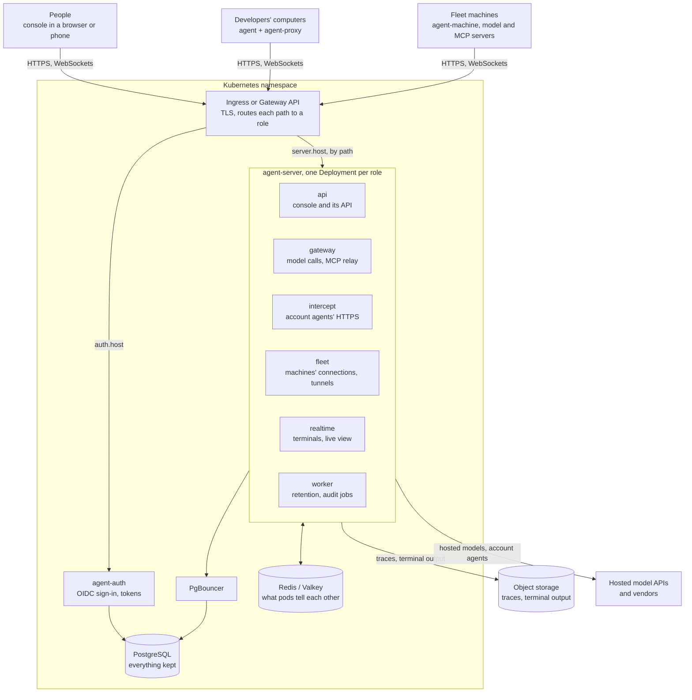

# Running it in an enterprise

This page takes you from an empty Kubernetes cluster to a production install for a team or a company: the server in scaled mode, highly available PostgreSQL, Redis, object storage for recordings, HTTPS on your own host names, and the operations after that. It's a runbook. Each step links to the reference that has every option:

- [Running several server processes](scaling.md): roles, routing, metrics, blob storage, sizing.
- The chart's [README](../deploy/helm/agent-mesh/README.md): every value, routing, autoscaling, probes, monitoring, network policy.
- [Security](security.md) and [OIDC authentication](oidc.md): devices, tokens, sign-in.

To try the chart on your own computer first, use [Quickstart on Kubernetes](quickstart-kubernetes.md). For one team on one computer without Kubernetes, [Deployment](deployment.md) (Docker Compose with PostgreSQL) is simpler.

## What you run

| Part | What it is | Where it comes from |
| --- | --- | --- |
| agent-server | The API, the model gateway, HTTPS capture, the fleet and terminals, split into roles: `api`, `gateway` (with `mcp`), `intercept`, `fleet`, `realtime`, `worker`, one Deployment each | `ghcr.io/joeyenfield/agent-server` |
| agent-auth | The OIDC issuer people and machines sign in with, two or more replicas | The same image |
| PostgreSQL | Accounts, settings, sessions, the audit log | CloudNativePG (the chart writes the `Cluster` and a PgBouncer `Pooler`) or your own |
| Redis | Presence, pub/sub and terminal streams shared between pods | The bundled Valkey (one instance) or your own |
| Object storage | Traces and terminal output, most of what's stored | S3 or anything that speaks its API |
| The console | The web UI | Served by the api role, or a standalone image you build |
| Machines | Computers running `agent-machine` and agents, anywhere | They dial out to the server; nothing in the cluster reaches them |

Everything reaches the outside world on two host names: `server.host` (the API, agents' traffic, machines, the console) and `auth.host` (sign-in). A third, `console.host`, is only for the standalone console.

## What each part does



Every arrow into the cluster is a connection made from outside. Machines and agents dial in, so nothing in the cluster needs to reach them.

| Part | What it does | If it stops |
| --- | --- | --- |
| Ingress or Gateway API | Ends TLS for `server.host` and `auth.host` and sends each path to the role that serves it (a wrong role answers 404). Must keep WebSockets open an hour or more and must not buffer streamed replies. Yours to supply; the chart writes the routes. | Nothing is reachable. |
| `api` | The console and its API: accounts, organizations, settings, machines' pages, sessions, requests, analytics, downloads. | The console is unavailable. Running agents keep working. |
| `gateway` | Agents' model calls (`/v1/*`, `/anthropic/*`, `/session/<id>/*`): checks the caller and usage limits, picks the provider, streams the reply and records it. Relays shared MCP servers unless `mcp` runs apart. | Model calls fail. Scale it on open streams. |
| `intercept` | Account agents (`claude-account`, `codex-account`, `copilot-account`, `antigravity-account`): decrypts their HTTPS with the server's CA, records it and reconnects to the vendor over verified TLS. | Account agents can't reach their vendor. Other agents are unaffected. |
| `fleet` | Holds each machine's connection, and the tunnels back to its model servers, MCP servers, terminals and launches. | Machines reconnect to another pod within seconds; calls to local models wait until they do. |
| `realtime` | Shared terminals and the live view: agents' terminal output to people watching or typing. | Viewers reconnect. The agents keep running. |
| `worker` | Jobs one process runs for the whole install: retention deletion, usage pruning, audit checkpoints and exports, the first admin. Two pods, one active. | Nothing people see. Deletion and exports catch up later. |
| `agent-auth` | The OIDC issuer: browser sign-in, device approval for `agent login` and `agent-machine login`, API credentials. Issues signed 30-minute access tokens that every server pod checks itself, and handles revocation. | No new sign-ins or refreshes. Tokens already issued work until they expire. |
| Migrate Job | `agent-server db migrate`, before the install and every upgrade (a Helm hook). Server pods wait for the schema. | The install or upgrade stops before any pod changes. |
| PostgreSQL | Everything kept: accounts, settings, sessions, request records, usage, the audit log. agent-auth has its own schema in the same database. | Everything stops. CloudNativePG fails over to a replica. |
| PgBouncer | Pools the server pods' connections in transaction mode. The worker, the migrations and agent-auth connect directly. | Server pods go unready. Run two. |
| Redis or Valkey | What pods tell each other: which pod holds which machine, live counters and limits, revoked tokens, terminal streams. Nothing in it is the only copy of anything kept. | Every server pod reports unready (`/ready` checks it), so the server is unavailable until it's back; then machines and viewers reconnect. The bundled Valkey is one instance: use a managed Redis or Sentinel for high availability. |
| Object storage | Most of what's stored by size: full traces, terminal output, audit checkpoint copies. | Every server pod reports unready (`/ready` checks it). Use a highly available store. |

In the small-team size (`values-single.yaml`) all six roles and agent-auth run in one pod, with SQLite in place of PostgreSQL, PgBouncer and Redis. The "if it stops" column is how the system is built to behave, not a measured guarantee: try each one in staging.

## Before you start

Decide and prepare these. The install itself takes minutes; this list is what takes days in a real organization.

1. **Kubernetes 1.25 or later**, with a default StorageClass, and nodes in at least two zones if you want zone spreading to mean anything.
2. **Host names and certificates.** Two HTTPS host names on subdomains of one site (for example `api.mesh.example.com` and `auth.mesh.example.com`). Sign-in cookies are host-only and `SameSite=Lax`, so they must share a site. **The certificate on `auth.host` must be one the server's image already trusts** (see [Private certificate authorities](#private-certificate-authorities)).
3. **Routing.** ingress-nginx, or a Gateway API implementation with a `Gateway` that has listeners for your hosts. Other Ingress controllers work, but need their own settings for long WebSockets and unbuffered streams (the chart's README, Routing).
4. **DNS inside the cluster.** The server's pods call the issuer at `https://<auth.host>` to check tokens. That name must resolve, from inside the cluster, to your ingress or load balancer, and the pods must be allowed to reach it. If your load balancer doesn't allow traffic to loop back from inside the cluster, use split-horizon DNS or a CoreDNS rewrite to the ingress controller's Service.
5. **PostgreSQL.** Either install the [CloudNativePG operator](https://cloudnative-pg.io/) (the chart writes the `Cluster` and `Pooler`, not the operator), or bring a managed or existing PostgreSQL 15 or later and create its roles once (the chart's README, An external PostgreSQL).
6. **Redis.** The bundled Valkey is one instance with AOF persistence. If it restarts, machines and terminal viewers reconnect after a few seconds. For high availability use a managed Redis or Sentinel through `redis.external`.
7. **An S3 bucket** and either an access key or a workload identity (IRSA, GKE Workload Identity, Azure Workload Identity). Decide on versioning and on lifecycle rules, but note that lifecycle rules don't know about legal holds ([Retention](retention.md)).
8. **Images.** If nodes can't pull from `ghcr.io` and `docker.io`, mirror `agent-server`, `valkey/valkey` and CloudNativePG's PostgreSQL image to your registry and set `image.repository`, `redis.bundled.image`, `postgresql.cloudnativepg.imageName` and `imagePullSecrets`.
9. **Optional operators:** cert-manager for certificates, the Prometheus Operator (`monitoring.*`), the External Secrets Operator (`secrets.externalSecrets`), the Prometheus adapter (autoscaling on connections).
10. **Who the first admin is.** Decide whether the chart's printed first password is enough, or set a bootstrap admin from a Secret (step 4).

## Pick a starting point

Start from one of the chart's example values files and keep your changes in a file of your own on top of it:

| File | For |
| --- | --- |
| `values-onprem.yaml` | Your own cluster: CloudNativePG with PgBouncer, the bundled Valkey, an S3-compatible store, ingress-nginx |
| `values-cloud.yaml` | Managed services: RDS behind RDS Proxy, ElastiCache, S3 through IRSA, secrets from AWS Secrets Manager through External Secrets |
| `values-scaled.yaml` | PostgreSQL and Redis you already run, the standalone console, Gateway API |

The steps below use `values-onprem.yaml`. The others differ only in where the database, Redis and secrets come from.

## Install, step by step

### 1. The namespace and the app Secret

```bash
kubectl create namespace mesh
kubectl -n mesh create secret generic mesh-app \
  --from-literal=internal-token="$(openssl rand -hex 32)" \
  --from-literal=oidc-introspection-secret="$(openssl rand -hex 32)" \
  --from-literal=vault-keys="$(agent-server vault key)"
```

`agent-server vault key` runs anywhere the server is installed, or in its image: `docker run --rm --entrypoint agent-server ghcr.io/joeyenfield/agent-server:<version> vault key`. **Keep a copy of the vault key outside the cluster and outside database backups.** Without it, stored subscription tokens can't be read ([Subscriptions](subscriptions.md#the-vault)).

### 2. The storage Secret and TLS

```bash
kubectl -n mesh create secret generic mesh-s3 \
  --from-literal=AWS_ACCESS_KEY_ID=<key id> --from-literal=AWS_SECRET_ACCESS_KEY=<secret>
kubectl -n mesh create secret tls mesh-tls --cert=<chain.pem> --key=<key.pem>   # or let cert-manager make it
```

### 3. Your values

A file of your own, `mesh-values.yaml`, on top of `values-onprem.yaml`:

```yaml
image:
  tag: "2.1.70"              # pin it; empty means the chart's appVersion

server:
  host: api.mesh.example.com
  forwardedAllowIps: "10.0.0.0/8"   # your ingress controller's pod or node ranges
auth:
  host: auth.mesh.example.com
  issuer:
    forwardedAllowIps: "10.0.0.0/8"

postgresql:
  cloudnativepg:
    storage: {size: 100Gi, storageClass: fast-ssd}
    backup:                 # CloudNativePG's barman object store
      barmanObjectStore:
        destinationPath: s3://mesh-pg-backups/
        endpointURL: https://s3.example.com
        s3Credentials:
          accessKeyId: {name: mesh-s3, key: AWS_ACCESS_KEY_ID}
          secretAccessKey: {name: mesh-s3, key: AWS_SECRET_ACCESS_KEY}
      retentionPolicy: 30d
redis:
  bundled:
    persistence: {enabled: true, size: 8Gi, storageClass: fast-ssd}

objectStorage:
  url: s3://mesh-traces/agent-mesh
  endpoint: https://s3.example.com
  existingSecret: mesh-s3

networkPolicy:
  publicFrom:
    - namespaceSelector: {matchLabels: {kubernetes.io/metadata.name: ingress-nginx}}

retention:                  # seeds the policy on the first install only
  days: {traces: 30, terminal: 30, sessions: 400, audit: 365}
```

The two that are easy to miss:

- **`forwardedAllowIps`.** Until you set your ingress ranges, every visitor through the ingress looks like one address. agent-auth's sign-in rate limit counts by address, so a few wrong passwords lock everyone out for ten minutes. Use `*` only when `networkPolicy.publicFrom` lets nothing but your proxies reach the pods.
- **`image.tag`.** Pin it, and change it on purpose. Upgrades then happen when you run `helm upgrade`, not when a node pulls a new image.

### 4. The first admin

On its first start against an empty database, the worker creates `admin` with a random password and prints it once in its log. The file copy it writes is on an `emptyDir`, so it's gone with the pod. If the pod is replaced before you read the log, reset the password with `kubectl -n mesh exec -i deploy/mesh-agent-mesh-api -c agent-server -- agent-server user passwd admin`.

To decide the admin yourself instead, give it from a Secret. It's an account outside the users table, and it stops the generated one:

```bash
kubectl -n mesh create secret generic mesh-admin --from-literal=username=meshadmin --from-literal=password='<long password>'
```

```yaml
auth:
  bootstrapAdmin: {existingSecret: mesh-admin}
```

### 5. Install

```bash
helm install mesh deploy/helm/agent-mesh -n mesh \
  -f deploy/helm/agent-mesh/values-onprem.yaml -f mesh-values.yaml --timeout 15m
```

What happens, in order:

1. CloudNativePG bootstraps the `Cluster`: database `mesh`, roles `mesh_api` and `mesh_auth`, schemas `mesh` and `mesh_auth`. Then it starts the replicas and the PgBouncer `Pooler`.
2. A Job (`mesh-agent-mesh-migrate-install`) runs `agent-server db migrate` against the primary directly, retrying while the database comes up.
3. The server's pods wait for the schema (`AI_PROXY_MIGRATE=0`), then become ready. agent-auth migrates its own schema.

Watch it:

```bash
kubectl -n mesh get cluster,pooler,jobs,deploy -w
kubectl -n mesh logs job/mesh-agent-mesh-migrate-install
```

On a cluster that already has the images, every role is ready within a minute or two. A pod that stays unready for 10 minutes and restarts says why in its log, almost always `waiting for the database to reach version N`, which means it can't reach the database (see [When something is wrong](#when-something-is-wrong)).

### 6. Check it

```bash
curl -fsS https://api.mesh.example.com/health
curl -fsS https://api.mesh.example.com/ready          # names the check that failed, if any
curl -fsS https://auth.mesh.example.com/.well-known/openid-configuration
curl -sI http://api.mesh.example.com/ | head -1      # a redirect to https
```

Then sign in to the console at `https://api.mesh.example.com` as the first admin, and change the password. On **Server settings › Storage** check that the database is PostgreSQL through the pooler and that recordings go to your bucket.

### 7. Machines and people

- People install `agent` from the server's Downloads page and run `agent login https://api.mesh.example.com` ([Agents](running-agents.md)).
- Computers that run agents or model servers join the fleet with `agent-machine login` and `agent-machine start` ([Machines](machines.md)). They only dial out to `server.host`, so they can sit behind NAT or on laptops.
- Make organizations, teams and accounts on **Organizations** ([Accounts and sharing](accounts.md)). Scripts and CI use [API credentials](api-credentials.md), not people's accounts.
- For the Downloads page and `agent update` to hand out builds, give the server a volume with `dist/<version>/` (`downloads.existingClaim`), filled by `agent-server downloads fetch`.

## Private certificate authorities

The server checks people's tokens with the issuer over HTTPS, and it trusts only the public certificate authorities bundled in its image. It doesn't read `SSL_CERT_FILE`, and the chart has no value for a CA bundle. So **if `auth.host` has a certificate from a private or corporate CA, every request fails to authenticate.** The same applies to an S3 endpoint and hosted model APIs reached through a TLS-inspecting proxy.

Until there's a setting for it, either:

- put a publicly trusted certificate on `auth.host` (and the S3 endpoint), or
- build an image of your own that adds your CA to the bundle, push it to your registry, and set `image.repository`:

```dockerfile
FROM ghcr.io/joeyenfield/agent-server:2.1.70
USER root
COPY corp-root-ca.pem /tmp/corp-root-ca.pem
RUN cat /tmp/corp-root-ca.pem >> "$(python -c 'import certifi; print(certifi.where())')" && rm /tmp/corp-root-ca.pem
USER agent
```

Rebuild it for every version you upgrade to.

## Operating it

### Upgrades

1. Read the release notes for the version, especially database and protocol changes ([Deployment](deployment.md#versions-and-updates)).
2. Change `image.tag` and run `helm upgrade` with the same values files. A pre-upgrade hook migrates the database first, then each role rolls with `maxUnavailable: 0`. Old and new pods run together during the rollout, which a newer database allows.
3. Machines and `agent` reconnect by themselves. Update them from the console's Machines page or with `agent update` when you're ready.

Machines and terminal viewers reconnect to another pod when theirs stops, and streamed replies get the pod's grace period to finish. That's the intended behaviour, not a measured guarantee: try a rollout under real load in staging first ([scaling.md](scaling.md#the-helm-chart)).

### Backups and recovery

| What | How |
| --- | --- |
| PostgreSQL | CloudNativePG's `backup` (base backups and WAL to object storage), or your managed service's. Test a restore into a new cluster. |
| Recordings | The S3 bucket: versioning or replication, under your own policy. |
| The vault key | Outside the cluster and the database backups. Losing it makes stored subscription tokens unreadable. |
| The app Secret, CloudNativePG role Secrets | They're kept on uninstall (`helm.sh/resource-policy: keep`). Back them up with the database, or regenerate them on restore. |
| Settings | `agent-server config export` writes every setting as YAML. It contains no secrets, so it can go in version control. |

### Monitoring

Turn on `monitoring.serviceMonitor` and `monitoring.prometheusRule` with the Prometheus Operator. You get per-pod `agent_server_*` metrics labelled by role, CloudNativePG's pod monitors, and alerts for pods down, not ready or restarting. The metrics are listed in [scaling.md](scaling.md#health-readiness-and-metrics), the alerts in the chart's README.

### Scaling

Every role has an HPA on CPU. Gateway and fleet scale better on their connections (`open_streams`, `fleet_sockets`) through the Prometheus adapter (the chart's README, Autoscaling). The sizing table in [scaling.md](scaling.md#sizing) is a starting point, not a measured capacity: load-test with your own agents before you rely on it.

### Security

Go through [A checklist for a public server](security.md#a-checklist-for-a-public-server). The ones specific to Kubernetes:

- Keep `networkPolicy.enabled`, and set `publicFrom` to your ingress controller. The internal port (9100) is never routed. Only the release's server pods and Prometheus can reach it.
- Egress stays open on purpose: the gateway calls hosted model APIs and HTTPS capture reaches public hosts. Restrict it with your own egress policy or proxy if you need to, keeping the issuer, the database, Redis and your bucket reachable.
- Turn on `containerSecurityContext.readOnlyRootFilesystem` once you've checked your version against it.
- The audit log is hash-chained. Its checkpoints can go to an S3 bucket with Object Lock ([The audit log](audit.md)).

### Removing it

`helm uninstall` leaves the data: the app Secret, the CloudNativePG role Secrets, the `Cluster` and its volumes. Delete them by hand when you mean to. Deleting the namespace doesn't touch your bucket, database backups, or a database outside the cluster.

## When something is wrong

| Symptom | Likely cause |
| --- | --- |
| Server pods log `waiting for the database to reach version N (it is at 0)` while the migration Job has completed | They can't reach the database through PgBouncer. `kubectl -n mesh logs deploy/mesh-agent-mesh-pg-pooler-rw` says why (a failed login, or `auth_query` permissions). The worker and agent-auth connect directly, so they can look healthy meanwhile. |
| CloudNativePG's `initdb` Job fails over and over | Its log has the failing SQL. A `syntax error at or near "$"` is the bootstrap SQL of charts released up to 2.1.69, and `permission denied` in the pooler's log is theirs too: install the 2.1.70 chart or later. |
| Everything is ready, but every signed-in request is refused | The server can't reach or trust `https://<auth.host>`: DNS inside the cluster, a load balancer that doesn't loop back, or a private CA (above). From an api pod, with the same trust as the server: `python -c "import httpx; print(httpx.get('https://<auth.host>/.well-known/openid-configuration').status_code)"`. |
| Sign-in is locked for everyone after a few wrong passwords | `auth.issuer.forwardedAllowIps` isn't set to the ingress ranges. |
| `/ready` answers 503 | It names the check: database, Redis or blob storage. |
| Machines keep reconnecting | Long-lived WebSockets cut by an idle timeout on the ingress, the load balancer or a proxy in between. Keep every hop's timeout above an hour for the fleet and realtime paths. |
| Agents' replies stop mid-stream | Response buffering or a short read timeout on the gateway's paths. |

## Testing the chart before a rollout

Render and validate your exact values before installing them:

```bash
helm lint --strict deploy/helm/agent-mesh -f deploy/helm/agent-mesh/values-onprem.yaml -f mesh-values.yaml
helm template mesh deploy/helm/agent-mesh -n mesh -f deploy/helm/agent-mesh/values-onprem.yaml -f mesh-values.yaml \
  | kubeconform -strict -summary -schema-location default \
    -schema-location 'https://raw.githubusercontent.com/datreeio/CRDs-catalog/main/{{.Group}}/{{.ResourceKind}}_{{.ResourceAPIVersion}}.json'
```

Then install into a staging namespace or cluster and go through step 6, a sign-in, one agent session through the gateway, a machine joining the fleet, and a `helm upgrade` to the same version (it runs the migration hook and a full rollout). The whole on-prem form has been installed this way on a three-node kind cluster, with CloudNativePG, PgBouncer, Valkey, an S3-compatible store and ingress-nginx with TLS.
